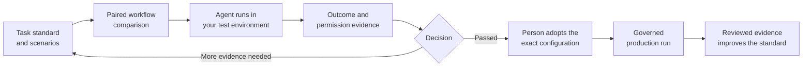

# How do I test a complete agent workflow?

Add versioned scenarios to the agent task’s **Standard**, start a complete-workflow comparison from **Changes**, and run the assigned trials in your own test environment with the Orlo SDK. Orlo checks declared outcomes and permission receipts, compares the same scenario families across configurations, and lets a person adopt an exact passing configuration for production.

## Define what success means

Open the agent task and use **Standard → Agent scenarios → Import scenarios**. A scenario freezes:

- initial test state and scripted interactions;
- the available test tools;
- an environment and simulator version;
- the outcome and permission checks;
- maximum turns, tool calls, time, and optional cost; and
- whether the scenario is for development or confirmatory evidence.

Every scenario needs a mandatory outcome check against authoritative test state. A model saying that it finished is not enough. Permission checks use Orlo’s own saved decisions. Application reports and model judgments cannot replace mandatory independent evidence.

Use **Development** while you change prompts, tools, or agent code. Use **Confirmatory** only for the final decision. A confirmatory scenario version can be used by one comparison; create a new version for the next final test so revealed outcomes do not become tuning data.

Use **Development** while you change prompts, tools, or agent code. Use **Confirmatory** only for the final decision. A confirmatory scenario version can be used by one comparison; create a new version for the next final test so revealed outcomes do not become tuning data.

## Compare complete configurations

In **Changes**, choose **Compare complete agent workflows** and supply a baseline and one or more candidate manifests. Each manifest identifies the agent artifact, runtime, model settings, task version, shared instructions, sources, tool schema, and permission specification.

Orlo creates the same planned trials for every configuration. Your runner claims them and executes your agent in your test environment. The compact progress card shows completed, invalid, failed, cancelled, remaining, and approval-paused attempts. Open a comparison to inspect evidence dimensions, scenario-family results, frozen configuration, and individual runs. Expand a run’s **Evidence** section to see the exact verifier result, evidence source, implementation hash, reason, and bounded observed payload. Expand a run’s **Evidence** section to see the exact verifier result, evidence source, implementation hash, reason, and bounded observed payload.

## Read the result

| Result | Meaning |
| --- | --- |
| Passed | The fixed comparison supports the declared non-regression threshold and all mandatory evidence passed. |
| Regressed | The candidate lost more than allowed, or a mandatory requirement failed. |
| More evidence needed | The valid evidence cannot distinguish the configurations under the declared plan. |
| Invalid evidence | A required result is missing, contradictory, or could not be checked. |

The first method is a fixed-sample paired frequentist comparison. Failures remain evidence; they are not retried until they disappear. A safe infrastructure failure can be retried deliberately, while a runner loss after possible side effects is marked uncertain and never replayed automatically. Failures remain evidence; they are not retried until they disappear. A safe infrastructure failure can be retried deliberately, while a runner loss after possible side effects is marked uncertain and never replayed automatically. Related variants and repetitions are combined within their declared scenario family before the interval is calculated. Extra turns and repeated runs do not pretend to be new independent cases.

## Adopt a passing configuration

A pass does not change production. On a completed confirmatory comparison, choose **Use configuration**. Orlo records the exact tested manifest and keeps earlier qualifications available for deliberate rollback.

Tasks stay advisory unless an administrator changes **Release policy → Complete agent workflow** to required. Required mode refuses a production session with no active qualification, a changed task standard, different shared instructions, or any other manifest change. The check occurs when the session starts; normal permission and revocation checks still apply to every action.

## What this test establishes

A complete-workflow comparison establishes what the declared scenarios and verifiers observed under the frozen plan. It does not prove that scenarios represent future traffic, that a customer verifier is correct, or that an unwrapped tool was governed. A declared external artifact identity is inspectable but is only independently verified when the build integration supplies verified provenance.

[Run the trials from your application](/engineers/test-complete-agent-workflows). [Require the tested configuration in production](/engineers/require-tested-agent-configuration).
