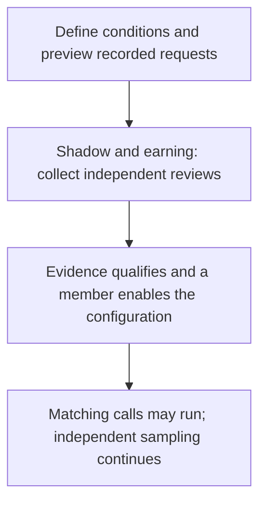

# What happens before a permission has enough evidence?

A new measured permission starts with approval required. Orlo observes calls and collects independent reviews while people decide individual actions. It grants no automatic permission until the evidence qualifies and an authorized member enables the specific configuration.

## Start with a narrow proposal

In **Agent runs**, open the agent’s permissions and define a tool with typed argument conditions. For example, limit `refund.issue` to a stated amount and currency. Preview the proposal against recorded requests, then save it in **shadow**. Historical replay shows what the proposal would have decided; it does not establish eligibility.

In shadow and earning, the band still requires approval. Independent reviews include a random sample of calls, so repeated approvals alone do not qualify the band. [Review an independent sample](/console/agent-runs/independent-review).

## Keep the evidence tied to the configuration

Have the application [declare its model and runtime revision](/engineers/permission-context). Missing declarations cannot earn permission. A new model, changed task standard, or unfamiliar configuration needs its own qualifying evidence; it cannot inherit permission from another configuration.

Open **View evidence and status** to see review coverage, agreement, potential harm, and missing evidence. The minimum review count is only one requirement. [Read the thresholds and confidence bounds](/console/agent-runs/confidence-bounds) before deciding whether this approach fits the volume of your workflow.

Exact-call human approvals remain available while the band earns evidence. Stricter organization permissions still apply.
