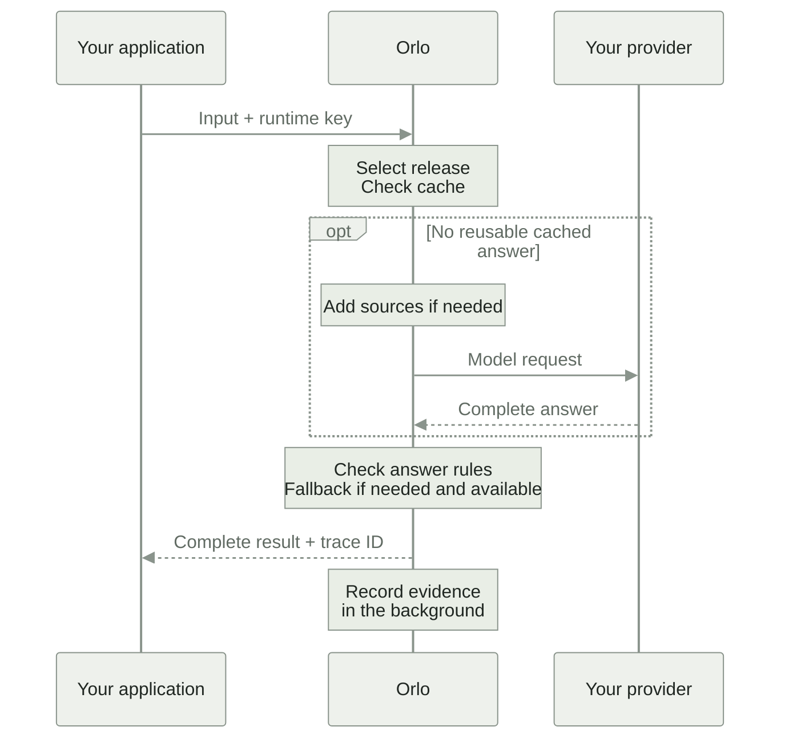
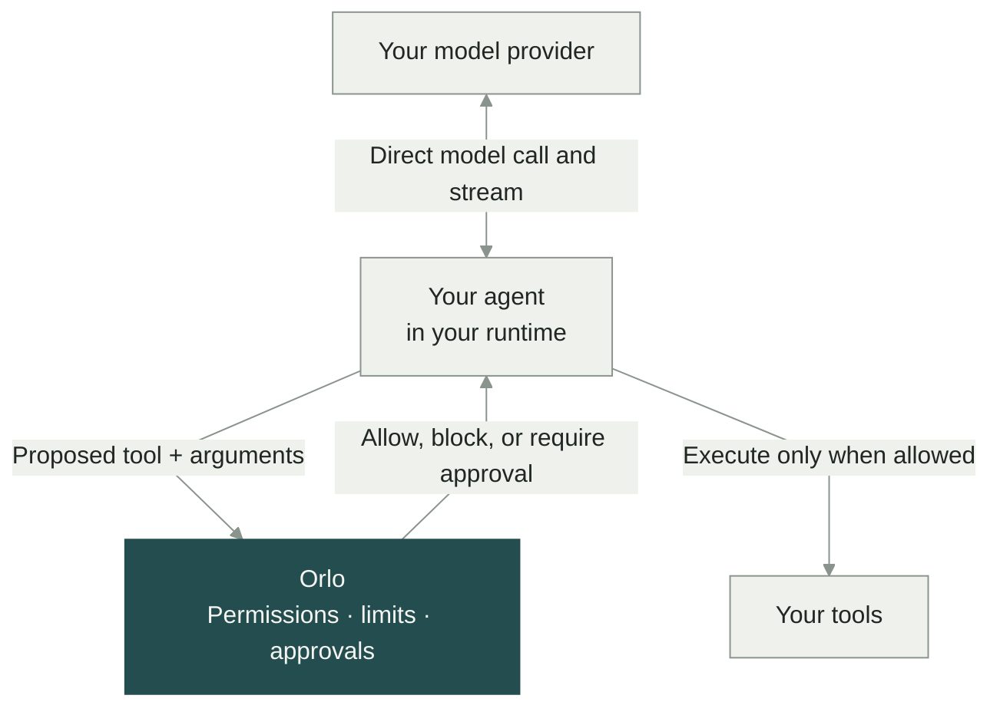

# How Orlo works

Orlo brings your team’s instructions, answer rules, and action permissions into production. You can send it a task to complete, or connect an agent that already runs in your application.

| | Task requests | Agent steps |
| --- | --- | --- |
| What you get | A complete answer checked against the task’s rules | A decision before a tool acts, with a record of the submitted work |
| Who calls the model | Orlo, using your organization’s provider credential | Your application, using its existing model and provider |
| Where to connect | Task API or OpenAI-compatible chat endpoint | SDK around your tools and relevant steps |
| Streaming | Complete responses, without token streaming | Your existing provider stream can stay direct |

You can use both paths in the same application. For example, a support agent can use a task to classify a ticket, then ask permission before changing the customer’s account.

## Task requests return a checked answer

Use this path when your application needs a result: route a support ticket, answer a question from source documents, or extract fields from a contract. Orlo handles the model request and the answer checks in one API call.

1. **Send the input.** Call `POST /v1/tasks/:id/run` with a runtime key that has `inference.run`. Orlo uses the saved task instructions and pinned skills. With `POST /v1/chat/completions`, you supply the messages and identify the task with `X-Orlo-Task-Id`.
2. **Use the selected release.** An explicit `deployment_id` on the task endpoint must name a live release for that task. Otherwise, Orlo uses an eligible routing-policy choice, then the live release if no choice is available. Use comparisons to test unreleased candidates.
3. **Prepare the answer.** Orlo can reuse eligible cached answers for low-temperature requests without sources. Source-backed releases retrieve relevant passages at request time. When a model call is needed, Orlo uses your organization’s provider credential.
4. **Check the complete answer.** Orlo applies the task’s answer rules. A configured, available fallback can be tried after a provider failure or when the task’s retry behavior calls for it. The fallback answer is checked too.
5. **Return the result.** A successful task response includes `output`, `validation`, and `trace_id`. A successful chat response puts the answer in `choices[0].message.content` and the validation status in `x-orlo-validation`. A rejected answer returns an error; a warning can accompany an answer your application must decide whether to use.

The request waits for a complete result. These endpoints do not stream tokens. Request evidence is recorded in the background and may appear in the console after the response.

Start with [Run a task](/engineers/run-a-task) or [Chat completions](/engineers/chat-completions).

## Agent permissions check actions in your runtime

Use this path when an agent already runs in your application. Keep its framework, model, provider, and tools. Add Orlo where a proposed action needs a decision before it takes effect.

Before a wrapped tool runs, the SDK sends the proposed step to `steps/govern`. Integrations can also use the dedicated `tools/check` endpoint. Orlo decides whether the action may proceed; the SDK enforces the decision in your runtime. An allowed action runs locally. A rejection stops it. A request for approval leaves it waiting for a person. A containment decision stops the run.

Orlo does not make or proxy this agent’s model call. Model-call records and completed outputs are normally reported in the background. Tool requests and retrieval steps wait for Orlo; model outputs and tool results also wait when the session’s rules or schemas require checks. The SDK follows the session’s `blocking_step_types` contract.

**Keep your existing stream.** Use your provider client or framework to stream directly to the user, and wrap the tools it dispatches. If an answer must pass a check before the user sees it, buffer it and wait for the model-output decision before displaying it. The current model wrappers work on completed outputs; they do not supply a streaming adapter.

Only submitted steps are covered. Put the SDK at your tool dispatcher so every relevant call goes through it. [Approval webhooks](/engineers/webhooks-and-approvals) tell your application when a held step has a decision; your runtime resumes the saved work.

Start with the [TypeScript SDK](/engineers/agent-sdk-typescript), [Python adapter](/engineers/python-and-langgraph), or the [connection check](/start/first-agent).

## Use production evidence to improve the next release

Both paths give your team records to review: task answers and rule results, or agent steps and permission decisions. Reviewed corrections and saved examples can join the task’s standard and feed the next comparison. [Follow the review-to-release workflow](/console/tasks/improve-from-production).

[Shared skills](/console/skills/shared-skills) give tasks, agents, and employees’ AI apps versioned instructions from the same organization.
